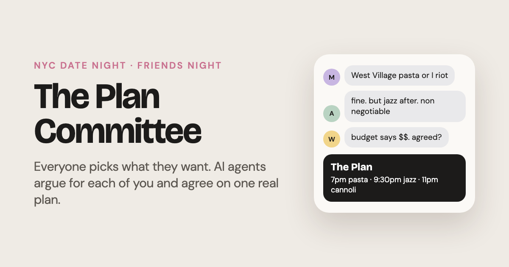
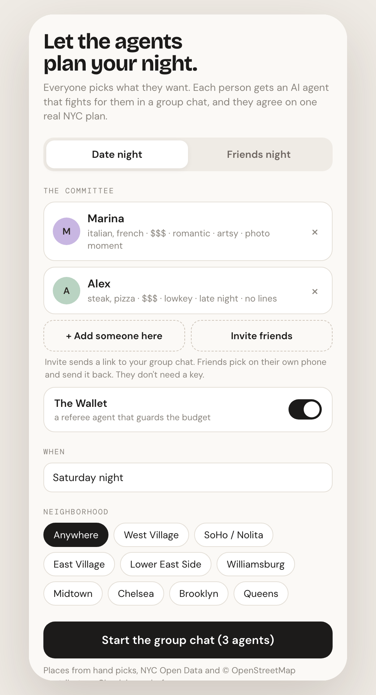

<p align="center"></p>

<h1 align="center">The Plan Committee</h1>

<p align="center">
  Everyone picks what they want. Each person gets an AI agent that fights for them in a group chat.<br>
  They agree on one real NYC plan: dinner, drinks, something after.
</p>

<p align="center">
  <a href="https://plan-committee.pages.dev/"><b>Try it live</b></a> ·
  <a href="https://plan-committee.pages.dev/?mock">Try it with no AI key</a> ·
  <a href="CONTRIBUTING.md">Contribute</a>
</p>

<p align="center">
  <a href="LICENSE"></a>
  
  
</p>

If you like it, a ⭐ helps other people find it.

## What it does



* **Date night or friends night.** Add your people, or send an invite link to the group chat so everyone picks on their own phone. Friends never need a key or an account.
* **Your people, saved.** Send friends a profile link: 6 quick taps and their taste and agent personality are saved on your phone. Next time you just tap who's coming.
* **Agents with personalities.** Dramatic, stubborn, chill, the mediator, chaotic. An optional Wallet agent guards the budget.
* **Any city.** New York and London so far. Each city is one folder in [`cities/`](cities), so adding yours is one pull request ([how](CONTRIBUTING.md)).
* **Real places only.** 125 hand picked spots, plus thousands more from NYC Open Data and OpenStreetMap, refreshed every day. Closed restaurants drop out on their own.
* **A plan you can use.** Map, website, reserve (straight to Resy or OpenTable when we know the page), add to calendar, share the whole argument as a replay link.
* **Your AI, your key.** Bring a free Gemini or Groq key (one minute, no card). It stays on your device and goes only to the AI you picked.
* **Installable.** Add it to your home screen and it opens like an app.

<br clear="right">

## How it works

* **No server, no build step.** The whole app is [`index.html`](index.html). Open it in a browser and it runs.
* **No database.** Plans, picks and invites live in the link itself (after the `#`, which never reaches any server) and in your browser.
* **The spot list grows by itself.** For every city, a daily GitHub Action ([`pipeline/build_spots.py`](pipeline/build_spots.py)) pulls fresh data, filters out chains and takeout spots, and has a free AI tag new places by vibe, price and cuisine. Places the AI doesn't recognize are skipped, so it never makes up vibes. Neighborhoods come from NYC's official map, not the AI.
* **Locked down.** A hash based Content Security Policy, a service worker that never touches AI calls, and a security scan on every pull request. See [SECURITY.md](SECURITY.md).

## Run it yourself

```
git clone https://github.com/marinasofia/plan-committee.git
cd plan-committee
python3 -m http.server 8000
```

Open http://localhost:8000/?mock for scripted agents with no AI key, or http://localhost:8000 to use your own key.

### Host your own copy (free)

1. Fork the repo.
2. In Cloudflare (free, no card): **Workers & Pages > Create > Pages > Connect to Git**, pick your fork. Framework preset **None**, no build command, output directory `/`. Every push to `main` deploys on its own, and `_headers` adds the security headers.
3. For the daily spot updates, add a free `GROQ_API_KEY` (console.groq.com/keys) and/or `GEMINI_API_KEY` (aistudio.google.com/apikey) under **Settings > Secrets and variables > Actions**, then run **Actions > Update spots** once.

GitHub Pages works too, but every repo on your `username.github.io` shares one origin, so any of them could read the AI keys people save in the app. Cloudflare gives the app its own address.

Free limits: about 40 batches of 25 places per run fits inside Groq's free daily tokens. The first week fills the backlog, then each run only tags new openings.

### Optional: usage counts (Cloudflare, free, no card)

```
cd worker
npx wrangler login
npx wrangler d1 create plan-committee        # copy the database_id into wrangler.toml
npx wrangler d1 execute plan-committee --remote --file=schema.sql
npx wrangler deploy                          # prints your worker URL
```

Paste the worker URL into `STATS_URL` near the top of the script in `index.html`, run `python3 tools/csp.py`, and add it as a repo **variable** named `STATS_URL`. Only place names and counts are stored, nothing about people. Before deploying it publicly, add rate limiting (see the open issues).

## Contributing

New spots, better agent banter, other cities, bug fixes: all welcome. Start with [CONTRIBUTING.md](CONTRIBUTING.md) and look for issues labeled **good first issue**.

## License and data

* Code: [MIT](LICENSE).
* Restaurant data: NYC Open Data (DOHMH Restaurant Inspection Results) and Neighborhood Tabulation Areas.
* Place data: © OpenStreetMap contributors, available under the [Open Database License](https://opendatacommons.org/licenses/odbl/). `cities/*/spots.json` and `data/tagged.json` are derived from it and are shared under the ODbL too.
